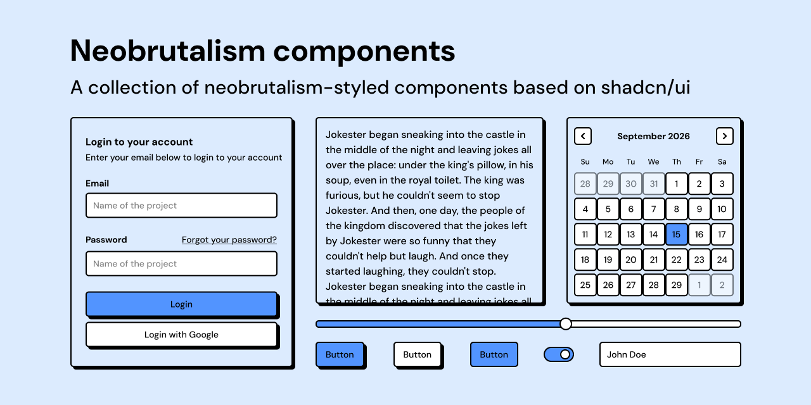

# Neobrutalism components



## Introduction

Neobrutalism components are a collection of neobrutalism-styled components for [Octane](https://octanejs.dev), based on the Octane port of shadcn/ui (`@octanejs/shadcn`) and built on Base UI (`@octanejs/base-ui`). It is an Octane port of [neobrutalism components](https://github.com/ekmas/neobrutalism-components) by [Samuel Breznjak](https://samke.me).

The same components for [Topcoat](https://github.com/tokio-rs/topcoat) (Rust) live in [neobrutalism-topcoat](https://github.com/joshua1/neobrutalism-topcoat).

## Documentation

Visit [docs](https://neobrutalism-octane.vercel.app/docs) to get started. Components install with the shadcn CLI from this site's registry, for example:

```sh
pnpm dlx shadcn@latest add https://neobrutalism-octane.vercel.app/r/button.json
```

## About 

I created this collection of components for people who want to learn more about neobrutalism style and to help them get started with creating neobrutalism layouts.

## License

[MIT](LICENSE), from the original [neobrutalism components](https://github.com/ekmas/neobrutalism-components/blob/main/LICENSE).
